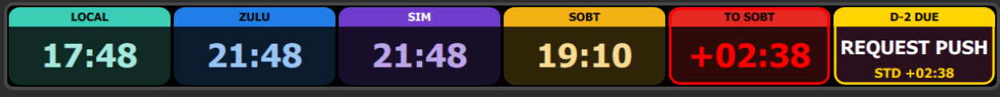

# MSFS SimClock

From ACMS Digital Systems, makers of [Datalink Pro](https://acmsdigital.com): a Windows app that puts a virtual ACARS terminal in your MSFS 2020 or 2024 cockpit, with an automated airline dispatch office on the other end.

A Stream Deck plugin with two actions, both working on keys and on Stream Deck + dials.
Place either as many times as you like; each instance is configured independently.

**SimClock** shows **PC time**, **real Zulu (UTC)**, **sim Zulu** — the clock inside
Microsoft Flight Simulator — SimBrief's scheduled off-block, or a countdown to it, as two
centered lines:

```
HEADER
HH:MM
```

**Departure Timeline** counts a list of reminders back from scheduled off-block, as three
lines:

```
NEXT D-15
DEPARTURE BRIEF
in 04:12
```

## Install

```
npm install
npm run build
streamdeck link com.acms.simclock.sdPlugin
```

Developer mode must be on (`streamdeck dev`) and **Stream Deck must be restarted** for it
to take effect. After that, `streamdeck restart com.acms.simclock` reloads the plugin
without restarting Stream Deck.

To produce a distributable installer:

```
npm run pack
```

That writes `dist/com.acms.simclock.streamDeckPlugin` — a plain ZIP containing the
`.sdPlugin` folder at its root, which installs on double-click.

## Ready-made profile

The plugin carries an **MSFS SimClock** profile for the Stream Deck + XL: LOCAL, ZULU, SIM, STD,
TO STD (alerts at 10, 5 and 0 minutes) and the Departure Timeline on the six dials, keys left
blank. It is `com.acms.simclock.sdPlugin/profiles/SimClock-PlusXL.streamDeckProfile`; open it
to add the profile. `python tools/make_profile.py` rebuilds it after the version changes.

## Settings

Per instance of **SimClock**. The timeline has its own, listed further down.

| Setting | Default | Notes |
|---|---|---|
| Time Source | PC Time | PC Time / Zulu / Sim Zulu / STD / Countdown to STD |
| Header | auto | Blank shows `LOCAL` / `ZULU` / `SIM`; type anything else, e.g. `KJFK` |
| Style | PANEL | PANEL or CLASSIC; see Style below |
| Font | Segoe UI | Any font family installed on this PC |
| Header Color | `#9AA0A6` | CLASSIC only |
| Time Color | `#FFFFFF` | CLASSIC only |
| Background | `#000000` | CLASSIC only |
| Transparent | off | CLASSIC draws no background at all; PANEL leaves out only the black behind its rounded corners |
| Countdown Alerts | _(blank)_ | Up to three minute/colour pairs; `Countdown to STD` only |
| SimBrief User | _(blank)_ | Global — entered once, shared by every clock and timeline |

Text shrinks to fit rather than clipping. It cannot be measured from Node, so width is
estimated from per-character advances chosen to over-estimate: a long header comes out
slightly smaller than it had to be instead of running off the key. Small is recoverable,
clipped is not.

## Style

**PANEL** (the default) is the look of the ChasePlane deck plugin: the key or dial section
is tinted a deep shade of its colour, a solid band across the top carries the header in
black or white (whichever reads better), the time sits in the middle in a light shade, and
a ring marks something active. Only flat shapes and text: Stream Deck's SVG renderer did
not draw blur or gradients in tests.



One colour per function:

| Shows | Colour |
|---|---|
| PC time | teal |
| Zulu | blue |
| Sim Zulu | purple |
| STD | gold |
| Countdown to STD | orange; red once `LATE` |
| Chronometer | green, ringed while running |
| Departure Timeline | pink; the band turns the Due colour while an item is due |

A crossed countdown alert rings the section in its colour and colours the time.

**CLASSIC** is the plain look from before, header over time in the colours you pick.

## Sim Zulu

Stream Deck plugins are sandboxed and cannot call SimConnect, so a small bridge process
does it. **You don't start it** — the plugin spawns `bridge/simclock_bridge.exe` when a
clock that needs sim time is placed, and stops it when the last one goes away.

To rebuild that executable after changing the Python:

```
npm run build:bridge
```

It reads the `ABSOLUTE_TIME` SimVar — seconds since `0001-01-01 00:00:00 UTC`, no epoch
offset — and serves it on `http://127.0.0.1:47600/time`. The plugin polls once a second.

Two details that matter:

- **The SimConnect request cache TTL is 2000 ms and must not be lowered.** At `_time=0`
  the SDK drains the message queue and every read returns `None`. The plugin absorbs that
  staleness by anchoring on each sample and advancing from its own monotonic clock.
- **Time compression is handled.** The bridge derives the sim's rate from consecutive
  *changed* readings against wall clock, so 4x cruise doesn't make the display jump each
  time a sample lands.

When the bridge is down or MSFS isn't running, Sim Zulu shows `--:--`. It never falls back
to real time — a wrong number under a `SIM` header is worse than no number.

Sim Zulu is the simulator's own UTC. It diverges from real Zulu as soon as you set a
departure time or compress time; that's the point of having both.

## SimBrief

`STD` shows scheduled off-block from your OFP; `Countdown to STD` shows that time minus
sim Zulu, so it tracks time compression. Past STD it counts up as `+MM:SS` and the auto
header changes to `LATE` — a header you typed yourself is always kept.

SOBT comes from `times/sched_out`, the same field Datalink Pro treats as authoritative.
`sched_off` is takeoff and `sched_in` is arrival; neither is the departure time.

Enter your SimBrief username once in any clock's Property Inspector. Your SimBrief profile
must have **publicly visible** enabled (Account → Privacy) or the API returns nothing.
No password is ever used.

The OFP is polled every 5 minutes — it only changes when you regenerate it, and hammering
SimBrief's API risks a rate limit. Placing or reconfiguring a SimBrief clock pulls a fresh
one immediately, rate-limited to once every 30 seconds.

## Departure Timeline

Reminders at fixed minutes before scheduled off-block. The three lines show the next one
with the time until it; when it falls due all three change to the Due colour and stay
there until it is acknowledged, or until the next one falls due — a missed reminder is
superseded rather than piling up. With everything past and acknowledged it reads
`COMPLETE`. With no OFP it reads `NO OFP`, and with no sim time `NO SIM`.

The list is a plain textarea, one reminder per line, minutes first. `35 BOARDING`,
`D-35 BOARDING`, `35: BOARDING` and `35=BOARDING` all parse; a line with no leading number,
or no label, is skipped rather than guessed at. Labels are upper-cased, and the list is
sorted largest-minutes-first, which is the order they fall due. The default is the AA 737
sequence — D-15 briefing, D-10 Before Start, D-3 doors, D-2 push — plus the ground-service
order ahead of it.

That default is written into the setting the first time an instance appears, so the panel
shows a real, editable example rather than an empty box: `sdpi-textarea` has no placeholder
property, so the attribute is silently dropped. Clearing the box falls back to the same
list, and only an absent setting is ever seeded.

| Input | Key | Dial |
|---|---|---|
| Press | Acknowledge what is due, else reload SimBrief | Same |
| Long press (0.6 s) | Clear every acknowledgement | Same |
| Rotate | — | Browse the list ahead; returns by itself after 10 s |
| Touch | — | Acknowledge |

Both are timed down-and-up, so the hold works on a button with no dial. A press while
browsing just returns to the live view.

Acknowledgements belong to the departure, not to the page. Switching Stream Deck pages
makes every instance disappear and reappear, so they are kept across it; a change to
scheduled off-block — a new OFP — clears them.

On a key the label wraps onto up to three lines, taking the largest size that fits both
the width and the band it has. A key is 144 px wide, so `WATER FUEL CATERING` on one line
lands at about 10 px; over two lines it is 20 px. One line stays centred on the same
baseline it always used. The dial is 200x100 with no room to stack, so it is always one
line.

| Setting | Default | Notes |
|---|---|---|
| Reminders | the 737 sequence | One per line, minutes first |
| Due Color | `#FFD400` | PANEL: band and ring while an item is due; CLASSIC: the top two lines |
| Demo | off | Runs on the PC clock against a pretend off-block |
| Demo Minutes | 62 | Pretend off-block, minutes from when the demo starts |

**Demo** needs no OFP and no MSFS, so a list can be tuned on the desktop. On a dial,
rotation moves the pretend clock a minute per detent instead of browsing, which walks a
whole departure in seconds. Turning demo on or off, or changing its minutes, restarts the
pretend clock; editing the list or the colours leaves it running so the change can be
watched.

A live timeline needs sim time, but only once there is an OFP to count down to — with no
scheduled off-block it reads `NO OFP` whether the bridge is up or not, so a timeline left
on the deck between flights does not hold `simclock_bridge.exe` open.

## Chronometer (dials)

On a Stream Deck + dial:

| Input | Action |
|---|---|
| Rotate | Set the target, one minute per detent (only while idle) |
| Press | Start / stop |
| Long press (0.6 s) | Reset, returning to the clock |
| Touch | Start / stop |

The chronometer belongs to the clock sources. On a dial set to `STD` or
`Countdown to STD` a press reloads SimBrief instead, and rotation is inert -- a dialled-in
target would otherwise make the chronometer active and hijack the display.

Set a target and it counts down; start from zero and it counts up. While active the
chronometer takes over the same two lines — `CHR` over `MM:SS`. Rotation is ignored while
running so a knock can't rewrite the target mid-timing.

## Tests

```
npm test
```

135 checks covering time formatting, the chronometer state machine, settings fallbacks,
SVG rendering including XML escaping of user input and key label wrapping, tick-boundary
scheduling, OFP epoch parsing, the countdown/late transition, countdown alert thresholds,
registry font parsing, timeline parsing and which reminder is due, and the Panel style.
No Stream Deck or MSFS required.

## Drawing cost

A clock showing `HH:MM` changes once a minute, so it is drawn once a minute -- not sixty
times. Three things keep it cheap:

- **Settings are cached** from `willAppear` / `didReceiveSettings`. The tick never asks
  Stream Deck for them, so the common path costs no IPC at all.
- **Identical draws are skipped.** Each instance remembers a signature of what it last
  sent; an unchanged one is never transmitted.
- **The ticker schedules itself.** With only real-time clocks placed it sleeps to the next
  minute boundary. It drops to 1 Hz when a chronometer is running, or when a Sim Zulu
  clock is placed -- time compression makes sim minutes elapse faster than real ones, so
  real minute boundaries would miss them. A placed timeline counts down in seconds, so it
  holds 1 Hz for as long as it is on screen.

With three clocks placed this is roughly three Stream Deck messages a minute rather than
three hundred and sixty.

## Layout

```
src/                    plugin source (TypeScript)
  plugin.ts             entry point; one self-scheduling ticker drives every instance
  clock-action.ts       the clock action: events, chronometer wiring, drawing
  timeline-action.ts    the timeline action: events, acknowledgements, browsing, demo
  render.ts             two-line and three-line SVG, with key label wrapping
  format.ts             HH:MM and MM:SS formatting (pure, tested)
  settings.ts           settings resolution and validation (pure, tested)
  timeline.ts           reminder parsing and which one is due (pure, tested)
  thresholds.ts         countdown alert colours (pure, tested)
  fonts.ts              installed font families, read from the registry (pure, tested)
  schedule.ts           minute-boundary tick math (pure, tested)
  ofp.ts                SimBrief epoch parsing (pure, tested)
  simbrief-feed.ts      polls the OFP for scheduled off-block
  bridge-process.ts     starts/stops the bridge exe on demand
  chrono.ts             chronometer state machine (pure, tested)
  sim-feed.ts           polls the bridge, extrapolates between samples
  time-source.ts        maps a source to a Date
bridge/                 Python SimConnect bridge
tools/make_icons.py     regenerates the plugin PNG icons
com.acms.simclock.sdPlugin/   the plugin itself (manifest, UI, images, built bin/)
```
